# Calculator Vault


-blue)


-informational)


| Platform | Min SDK | Target SDK | Compile SDK | Version |
|---|---|---|---|---|
| Android | 28 (Android 9) | 37 | 37 | `1.0.0` (versionCode `1`) |

## Description

Calculator Vault looks and works like an ordinary calculator. Type your 4-digit PIN and press
**=** and it opens a private vault for photos, videos, audio and documents. Everything in the
vault is encrypted on the device. The encrypted data is kept in a hidden folder in shared storage,
so it **survives an uninstall**: reinstall the app, enter the same PIN, and the vault comes back.

## Major Features

- **Calculator disguise.** A working four-function calculator with operator precedence, `%` and
  `±` is the lock screen. The PIN unlocks only when it is typed on its own followed by `=`.
- **Launcher disguises.** The icon and label can switch between Calculator, Music, Notes and Maps
  variants, using one `<activity-alias>` enabled at a time.
- **Encrypted vault.** Photos, videos, audio and files are encrypted with Tink AES256-GCM-HKDF
  streaming AEAD (1 MB segments, seekable for playback). Metadata and thumbnails use AES256-GCM.
- **Survives uninstall.** Master keys are wrapped with PBKDF2-HMAC-SHA256 keys derived from the
  PIN, pattern and security answer, not with Keystore keys, and stored next to the encrypted files.
  The settings and the wrapped config are also included in Android Auto Backup.
- **Built-in viewers.** A photo viewer with pinch zoom and slideshow, an ExoPlayer video player
  that streams decrypted segments on demand, an audio player with queue, shuffle, repeat, speed
  and an equalizer/reverb, and a PDF/text/image file viewer.
- **Import and in-app camera.** Import from device albums or the system file picker, with the
  originals removed after encryption. The CameraX camera encrypts photos and videos as soon as
  they are captured.
- **Trash.** Deleted items stay in the trash for 30 days and can be restored or deleted for good.
  Hidden items can also be unhidden back to public storage.
- **PIN recovery.** Recover with a fingerprint, an unlock pattern, a security question, or an
  email OTP (sent through a configurable backend).
- **Intruder detection.** After 1 to 6 wrong PINs (your choice) the attempt is logged, and a
  silent front-camera selfie can be taken. The photo is encrypted to the vault's public key while
  the vault stays locked.
- **App Lock.** Lock other installed apps behind your PIN, fingerprint or pattern. It uses a
  foreground service, usage access and an overlay activity, and restarts after a reboot.
- **Google Drive backup.** Incremental backup of the already-encrypted vault to Drive's hidden
  `appDataFolder`, with Wi-Fi-only or Wi-Fi + cellular options and restore.
- **Session security.** The vault re-locks when you leave the app, and after the next unlock it
  restores the exact screen you were on. It never shows in Recents (privacy cover plus
  `setRecentsScreenshotEnabled(false)`). Optional extras: screenshot blocking, panic mode (shake
  to close the vault), and uninstall protection through a device admin.
- **Personalization.** Light, dark or system theme. The language picker offers 12 languages plus
  the system default, through AppCompat per-app locales. Only English strings ship today; the
  other translations are still to be added.
- **Polished UI.** Screens use `@ScreenPreviews` (phone light/dark, landscape, tablet) and
  components use `@ThemePreviews` (light/dark). Layouts handle landscape, the app is edge-to-edge
  with predictive back, and screens share slide/fade transitions.

## Tech Stack

| Area | Library / Tool | Version |
|---|---|---|
| Language | Kotlin (JVM target 17) | 2.4.21 |
| Build | Gradle wrapper / Android Gradle Plugin | 9.6.0 / 9.4.1 |
| Code generation | KSP | 2.3.12 |
| UI | Jetpack Compose (BOM), Material 3, Material 3 Adaptive | 2026.09.00 / — / 1.3.0 |
| Navigation | Navigation 3 (`navigation3-runtime`, `navigation3-ui`) | 1.2.0 |
| Lifecycle | Lifecycle (ViewModel, runtime-compose, viewmodel-navigation3, process, service) | 2.11.0 |
| Dependency injection | Koin BOM + Koin Annotations (KSP) | 4.1.1 / 2.3.1 |
| Async | Kotlin Coroutines / Flow | 1.11.0 |
| Serialization | kotlinx.serialization JSON | 1.12.0 |
| Persistence | Room (vault index), DataStore Preferences (settings) | 2.8.5 / 1.3.0 |
| Cryptography | Google Tink (`tink-android`), JCA PBKDF2 + AES-GCM, Android Keystore | 1.24.0 |
| Media | Media3 ExoPlayer / UI / Session, CameraX, Coil 3 (+ video) | 1.11.1 / 1.6.2 / 3.6.3 |
| Networking | Ktor client (OkHttp engine, content negotiation, logging) | 3.6.0 |
| Google | Credential Manager, Google ID, Play Services Auth, Play In-App Review | 1.6.0 / 1.2.1 / 22.0.0 / 2.0.2 |
| Background work | WorkManager (Koin worker factory) | 2.11.2 |
| Biometrics | AndroidX Biometric | 1.1.0 |
| Logging | Timber (debug only, stripped by R8 in release) | 5.0.1 |
| Debug tooling | LeakCanary, StrictMode | 2.14 |
| Testing | JUnit 4, kotlinx-coroutines-test, Turbine, MockK, Koin Test, Compose UI Test, Espresso | 4.13.2 / — / 1.2.1 / 1.14.11 |

All versions are kept in [`gradle/libs.versions.toml`](gradle/libs.versions.toml).

## Architecture

The project follows the [Now in Android](https://github.com/android/nowinandroid) approach:
**multi-module Clean Architecture**, with **MVI** in the presentation layer and **convention
plugins** in [`build-logic`](build-logic/README.md).

```
 UI (Compose)  ──Intent──▶  MviViewModel  ──▶  UseCase  ──▶  Repository (interface, :core:domain)
      ▲                         │                                   │
      └──── State / Effect ─────┘                       RepositoryImpl (:core:data)
                                                     ┌──────────┬──────────┬──────────┬──────────┐
                                                 datastore   database   security   network   (files)
```

- **Presentation, MVI.** Every screen has a contract (`XState : UiState`, `XIntent : UiIntent`,
  `XEffect : UiEffect`) and a ViewModel that extends `MviViewModel` from `:core:ui`. The UI renders
  `state`, sends intents through `onIntent`, and collects one-off `effects` (navigation, toasts,
  system screens) with `CollectEffects`. State changes only through `setState` reducers.
- **Domain.** Repository interfaces and use cases shared across features live in `:core:domain`.
  Use cases used by a single feature stay in that feature's `domain/usecase` package. Pure models
  live in `:core:model`, a JVM-only module with no Android dependencies.
- **Data.** `:core:data` implements every shared repository on top of DataStore, Room, the
  encrypted file store, Tink and Ktor. Feature modules **never** depend on `:core:data`; only
  `:app` (and `:core:media`) do.
- **Dependency injection.** Koin Annotations with KSP. Each module declares a `@Module` with
  `@ComponentScan`, and `AppModule` in `:app` includes all of them. Definitions use `@Single`,
  `@Factory` and `@KoinViewModel`.
- **Navigation.** Navigation 3 with a process-scoped `Navigator` that owns the back stack. Every
  destination is a `@Serializable` `NavKey` in `:core:navigation`. Routes that implement
  `VaultRoute` show decrypted content: they are removed from the back stack on lock and restored
  after the next unlock. Each feature contributes `EntryProviderScope` entries
  (`photosEntries(navigator)` and so on) to the single `NavDisplay` in `:app`.
- **Vault session.** `SessionKeys` holds the decrypted master keys only while unlocked.
  Long-running jobs, such as an import still encrypting files, hold a lease so the keys are wiped
  only after they finish.

### Security model

| Secret | Protected by | Stored in | Survives uninstall |
|---|---|---|---|
| Master keys (streaming, AEAD, hybrid) | PBKDF2-HMAC-SHA256 (120k iterations) → AES-256-GCM wrap, one per PIN / pattern / answer | `vault.json` (app files + Auto Backup) mirrored to the shared vault folder | ✅ |
| Fingerprint and email-recovery convenience copies | Android Keystore (biometric-bound / device key) | `DeviceState` DataStore (excluded from backup) | ❌ (by design) |
| Item content / metadata / thumbnails | Tink streaming AEAD / AEAD | `<vault>/items/*.cvx`, `*.cvm`, `<vault>/thumbs/*.cvt` | ✅ |
| Intruder selfies | ECIES P-256 public key (no unlock needed) | vault folder | ✅ |

## Module Graph

```mermaid
graph TD
    app[":app"]

    subgraph feature["feature/* (19 modules)"]
        direction LR
        f_splash[":feature:splash"]
        f_lang[":feature:language"]
        f_onb[":feature:onboarding"]
        f_pin[":feature:pin"]
        f_rec[":feature:recovery"]
        f_calc[":feature:calculator"]
        f_home[":feature:home"]
        f_imp[":feature:importer"]
        f_photos[":feature:photos"]
        f_videos[":feature:videos"]
        f_audios[":feature:audios"]
        f_files[":feature:files"]
        f_cam[":feature:camera"]
        f_trash[":feature:trash"]
        f_set[":feature:settings"]
        f_theme[":feature:themes"]
        f_lock[":feature:applock"]
        f_intr[":feature:intruder"]
        f_cloud[":feature:cloudbackup"]
    end

    ui[":core:ui"]
    ds[":core:designsystem"]
    nav[":core:navigation"]
    domain[":core:domain"]
    data[":core:data"]
    media[":core:media"]
    datastore[":core:datastore"]
    database[":core:database"]
    security[":core:security"]
    network[":core:network"]
    common[":core:common"]
    model[":core:model"]

    app --> feature
    app --> data
    app --> media

    feature --> ui
    feature --> nav
    feature --> domain
    f_videos --> media
    f_audios --> media
    f_cloud --> network

    ui --> ds
    ui --> domain
    nav --> model

    media --> data
    media --> security
    data --> domain
    data --> datastore
    data --> database
    data --> security
    data --> network
    network --> domain

    domain --> model
    datastore --> common
    database --> common
    security --> common
    domain --> common
```



Each feature module also gets `:core:common`, `:core:model` and `:core:designsystem` through the
`calculatorvault.android.feature` convention plugin. The edges to those three modules are left out
of the diagram to keep it readable. `:app` depends on every module directly.

## Modules

### Core modules

| Module | Responsibility |
|---|---|
| [`:core:common`](core/common/README.md) | Constants, dispatchers, application scope, `LockGuard`, result helpers |
| [`:core:model`](core/model/README.md) | Pure Kotlin/JVM domain models (`VaultItem`, `UserSettings`, …) |
| [`:core:designsystem`](core/designsystem/README.md) | Theme (colors, Inter typography, shapes, spacing), icons, reusable Compose components |
| [`:core:ui`](core/ui/README.md) | MVI base classes, shared gallery logic, vault-aware composables, biometrics, UI utilities |
| [`:core:navigation`](core/navigation/README.md) | Navigation 3 `NavKey` routes and the process-scoped `Navigator` |
| [`:core:domain`](core/domain/README.md) | Repository interfaces and shared use cases |
| [`:core:data`](core/data/README.md) | Repository implementations, encrypted file store, vault config, workers |
| [`:core:datastore`](core/datastore/README.md) | DataStore Preferences: user settings and device-bound state |
| [`:core:database`](core/database/README.md) | Room index of vault items, intruder attempts and backup state |
| [`:core:security`](core/security/README.md) | Tink master keys, secret wrapping, Keystore keys, session keys |
| [`:core:network`](core/network/README.md) | Ktor client, Google Drive REST API, OTP API, network monitor |
| [`:core:media`](core/media/README.md) | Coil decrypting image loader, ExoPlayer encrypted data source, audio controller, intruder camera |

### Feature Modules

| Module | Screens / Responsibility |
|---|---|
| [`:feature:splash`](feature/splash/README.md) | Animated splash, first-install "Get Started" welcome, start-destination routing |
| [`:feature:language`](feature/language/README.md) | Language picker (system default + 12 languages), per-app locale |
| [`:feature:onboarding`](feature/onboarding/README.md) | 3-page onboarding pager with parallax illustrations |
| [`:feature:pin`](feature/pin/README.md) | Create PIN on the calculator keypad, change PIN, reset PIN |
| [`:feature:recovery`](feature/recovery/README.md) | Recovery method setup and "Forgot PIN" (fingerprint, pattern, email OTP, security question) |
| [`:feature:calculator`](feature/calculator/README.md) | The calculator lock screen, PIN entry, forgot-PIN prompt, intruder recording |
| [`:feature:home`](feature/home/README.md) | Vault shell: Home and Settings tabs, bottom bar, radial "+" menu, restore-vault dialog |
| [`:feature:importer`](feature/importer/README.md) | Pick device photos, videos, audio and documents to hide |
| [`:feature:photos`](feature/photos/README.md) | Photo grid and full-screen viewer (zoom, slideshow, rename, details, share, unhide) |
| [`:feature:videos`](feature/videos/README.md) | Video grid and ExoPlayer player streaming encrypted content |
| [`:feature:audios`](feature/audios/README.md) | Audio list, mini-player, full player, equalizer |
| [`:feature:files`](feature/files/README.md) | Document list and viewer (PDF, text, image), "Open with" |
| [`:feature:camera`](feature/camera/README.md) | CameraX photo/video capture straight into the vault |
| [`:feature:trash`](feature/trash/README.md) | 30-day trash: restore, delete forever, empty |
| [`:feature:settings`](feature/settings/README.md) | Settings tab, app icon disguise, uninstall protection, security toggles |
| [`:feature:themes`](feature/themes/README.md) | System / Light / Dark theme picker |
| [`:feature:applock`](feature/applock/README.md) | Lock third-party apps: app list, settings, foreground service, overlay |
| [`:feature:intruder`](feature/intruder/README.md) | Intruder log, selfie photos, wrong-PIN limit |
| [`:feature:cloudbackup`](feature/cloudbackup/README.md) | Google sign-in, Drive backup/restore, auto-backup and network options |

Every feature module uses the same package layout:

```
feature/<name>/src/main/kotlin/com/calculator/vault/feature/<name>/
├── data/                 # Feature-only repository implementations (optional)
├── domain/
│   ├── repository/       # Feature-only repository interfaces (optional)
│   └── usecase/          # Feature-only use cases
├── presentation/
│   ├── components/       # Stateless composables for this feature
│   ├── mvi/              # <Screen>Contract (State / Intent / Effect) + <Screen>ViewModel
│   └── ui/               # Screen composables (+ light/dark previews)
├── navigation/           # EntryProviderScope<NavKey>.<name>Entries(navigator)
└── di/                   # @Module @ComponentScan class <Name>Module
```

## Project Layout

```
CalculatorVault/
├── app/                        # Application module: MainActivity, Application, AppModule, VaultApp (NavDisplay)
│   └── src/main/keepRules/     # App-specific R8 rules
├── build-logic/                # Included build with convention plugins
│   └── convention/
├── core/
│   ├── common/  data/  database/  datastore/  designsystem/  domain/
│   └── media/   model/  navigation/  network/  security/  ui/
├── feature/
│   ├── applock/  audios/  calculator/  camera/  cloudbackup/  files/  home/
│   ├── importer/  intruder/  language/  onboarding/  photos/  pin/  recovery/
│   └── settings/  splash/  themes/  trash/  videos/
├── design/
│   ├── figma-cache/            # Cached Figma export (node tree, screen crops, SVG icons, images)
│   └── lucide/                 # Lucide (ISC) icons for features that aren't in the Figma file
├── gradle/
│   ├── libs.versions.toml      # Version catalog
│   └── wrapper/
├── compose_compiler_config.conf  # Compose stability configuration
├── build.gradle.kts
├── settings.gradle.kts
└── gradle.properties
```

## Build & Run

### Requirements

- **Android Studio** with AGP 9.4 support.
- **JDK.** The Gradle daemon runs on JDK 25, which is auto-provisioned through the Foojay
  toolchain resolver (`gradle/gradle-daemon-jvm.properties`). The modules compile to JVM 17
  bytecode.
- **Android SDK** with platform 37 installed.

### Clone and run

```bash
git clone https://github.com/alphito09-collab/calculator_vault.git
cd calculator_vault

# Build and install the debug variant on a connected device or emulator
./gradlew :app:installDebug

# Or just assemble the APK
./gradlew :app:assembleDebug        # app/build/outputs/apk/debug/
```

### Optional configuration (`local.properties`)

`local.properties` is git-ignored. Add these keys to it as needed:

```properties
# Base URL of the email-OTP backend used for PIN recovery (defaults to https://api.example.com/)
OTP_BASE_URL=https://your-backend.example.com/

# OAuth "Web application" client ID from Google Cloud Console, needed for Google sign-in / Drive backup
GOOGLE_WEB_CLIENT_ID=1234567890-abc.apps.googleusercontent.com
```

### Release signing (`keystore.properties`)

Create a git-ignored `keystore.properties` in the project root:

```properties
storeFile=path/to/upload.jks
storePassword=******
keyAlias=upload
keyPassword=******
```

If the file is missing, the release build is signed with the debug key. That way the R8-minified
build can still be installed and tested locally.

### Useful tasks

```bash
./gradlew :app:assembleRelease          # R8-optimized release APK
./gradlew :app:bundleRelease            # AAB for Play upload
./gradlew testDebugUnitTest             # JVM unit tests in all modules
./gradlew :feature:calculator:testDebugUnitTest
./gradlew connectedDebugAndroidTest     # Instrumented tests (device required)
./gradlew lint
```

Set `enableComposeCompilerReports=true` in `gradle.properties` to write Compose compiler
stability reports to each module's `build/compose-reports`.

## Build Variants

| Build type | Application ID | Debuggable | Minified (R8) | Logging | Extras | Vault folder |
|---|---|---|---|---|---|---|
| `debug` | `com.calculator.vault.hide.app.lock.photo.video.free.debug` | ✅ | ❌ | Timber `DebugTree`, Koin `INFO` | StrictMode, LeakCanary | `/storage/emulated/0/.calculator_vault_data_debug` |
| `release` | `com.calculator.vault.hide.app.lock.photo.video.free` | ❌ | ✅ (`optimization.enable = true`) | None. `Log.*` / `Timber.*` are removed by `-assumenosideeffects` | Signed from `keystore.properties` (falls back to the debug key) | `/storage/emulated/0/.calculator_vault_data` |

The `.debug` suffix lets both builds be installed side by side. They never share a vault folder.
Only the translations the app provides are packaged (`localeFilters`), and a locale config is
generated for per-app language support.

## Package and Application ID

| Item | Value |
|---|---|
| Application ID (release) | `com.calculator.vault.hide.app.lock.photo.video.free` |
| Application ID (debug) | `com.calculator.vault.hide.app.lock.photo.video.free.debug` |
| `:app` namespace | `com.calculator.vault.hide.app.lock.photo.video.free` |
| Launcher aliases | `com.calculator.vault.hide.app.lock.photo.video.free.alias.{Default, Calculator1‥4, Music1‥4, Notes1‥4, Maps1‥4}` |
| Core module namespaces | `com.calculator.vault.core.<module>`, e.g. `com.calculator.vault.core.security` |
| Feature module namespaces | `com.calculator.vault.feature.<module>`, e.g. `com.calculator.vault.feature.photos` |
| Build-logic group | `com.calculator.vault.buildlogic` |
| Convention plugin IDs | `calculatorvault.android.{application, application.compose, library, library.compose, feature, room}`, `calculatorvault.{koin, jvm.library}` |

Library namespaces are derived from the Gradle path by the library convention plugin
(`:feature:photos` → `com.calculator.vault.feature.photos`).

## Permissions

| Permission | Why |
|---|---|
| `MANAGE_EXTERNAL_STORAGE` (+ legacy `READ`/`WRITE_EXTERNAL_STORAGE`) | Hidden vault folder in shared storage that survives uninstall, removing originals |
| `READ_MEDIA_IMAGES` / `VIDEO` / `AUDIO` | Listing device media in the importer |
| `CAMERA`, `RECORD_AUDIO` | In-app camera and video, intruder selfie |
| `USE_BIOMETRIC` | Fingerprint unlock and recovery |
| `INTERNET`, `ACCESS_NETWORK_STATE` | Drive backup, OTP, connectivity checks |
| `FOREGROUND_SERVICE`, `FOREGROUND_SERVICE_DATA_SYNC`, `POST_NOTIFICATIONS` | Backup worker and progress notifications |
| `PACKAGE_USAGE_STATS`, `SYSTEM_ALERT_WINDOW`, `FOREGROUND_SERVICE_SPECIAL_USE`, `RECEIVE_BOOT_COMPLETED` | App Lock (declared by `:feature:applock`) |
| `BIND_DEVICE_ADMIN` (receiver) | Uninstall protection (declared by `:feature:settings`) |

## Testing

JVM unit tests use JUnit 4, coroutines-test, Turbine and MockK. Current suites:

- `core/model`: `FileKindTest`
- `feature/calculator`: `CalculatorEngineTest`, `ForgotPinPromptUseCaseTest`
- `feature/importer`: `ImporterViewModelTest`

The library convention plugin adds the test dependencies to every module automatically.
